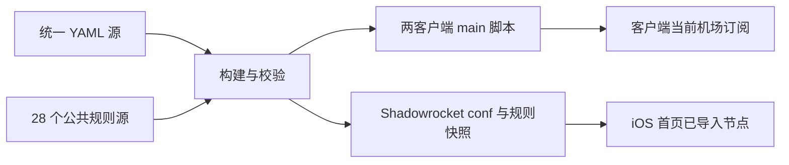

# 三平台统一分流

一份 YAML 源配置，生成 Clash Verge Rev、FlClash 的覆写脚本，以及 Shadowrocket 原生 `.conf`。
机场订阅始终由客户端保存。生成器不注入 DNS、Hosts、Fake-IP、DNS Policy 或顶层 IPv6 设置。

当前配置包含 **17 个软件/公司分组、3 个大类、38 个策略组、28 个公共规则集、49 条顶层规则**。
15 条个人规则保持顺序，其中 GitHub 指向自定义代理。`dnscheck.tools` 和测速 URL 均保留。
初次迁移的两份原脚本与固定基准保存在 `docs/` 和 `tests/fixtures/`，用于验证初始提取，不参与客户端运行。

项目仓库：[jay-183/mihomo-unified-routing](https://github.com/jay-183/mihomo-unified-routing)。
本地项目已经构建并测试；远程发布状态以 [GitHub Actions](https://github.com/jay-183/mihomo-unified-routing/actions) 为准。
下表提供该仓库的实际客户端地址，首次成功发布后生效。

## 目录与维护入口

| 文件 | 修改内容 |
|---|---|
| `src/user-rules.yaml` | 个人规则，逐条指定任意已有策略，严格保持顺序 |
| `src/regions.yaml` | 地区名称、关键词与正则；其他地区取已知地区的补集 |
| `src/proxy-groups.yaml` | 基础组、业务组和引用关系 |
| `src/rule-providers.yaml` | 全部公共规则来源与更新周期 |
| `src/rules.yaml` | 公共规则引用与兜底的原始顺序 |
| `src/settings.yaml` | 测速、容差、假节点过滤、静态节点 UDP |
| `adapters/` | 两种格式的转换实现 |
| `dist/` | 生成结果，不作为日常编辑入口 |
| `tests/fixtures/baseline.json` | 初次迁移的固定回归基准，不随日常规则修改更新 |



## 分层选择线路

软件默认跟随所属大类，大类默认跟随默认线路；Google 默认跟随默认线路，Apple、Microsoft 默认跟随直连模式。
默认线路默认选择美国节点，在美国节点中自动测速选择。客户端可能保留以前的选择，更新后请核对。

| 大类 | 软件 |
|---|---|
| 国外媒体 | YouTube、Netflix、Disney+、TikTok |
| AI 服务 | OpenAI、Gemini、Claude、Grok |
| 通讯社交 | Telegram、Discord、X、Facebook、Instagram、Reddit |
| 独立公司服务 | Google、Apple、Microsoft |

- 统一让媒体走美国：在「国外媒体」选「美国节点」，所有跟随大类的软件一起变更。
- 只有 YouTube 走日本：在「YouTube」选「日本节点」，Netflix 等仍跟随国外媒体。
- 恢复统一选择：把 YouTube 重新选回「国外媒体」。
- 各大类选「默认线路」时，由默认线路统一指定出口。

七个地区均以“节点”结尾，各自使用一个自动测速组，按节点名称筛选该地区的节点。需要指定具体节点时，
先在「手动选择」中选节点，再让对应软件或大类选择「手动选择」。该手动组的选择由所有引用它的分组共享。

支持 `YouTube → 国外媒体 → 默认线路 → 美国节点 → 测速选出的节点`，
也支持 `YouTube → 日本节点 → 测速选出的节点`。完整菜单和首次导入默认值见 [代理分组清单](docs/proxy-groups.md)。

直连规则统一指向「直连模式」，默认 DIRECT。个人规则始终先于公共规则，GitHub 的个人规则指向「自定义代理」。
未单独设置的软件由公司或通用规则接管。

「美国故障转移」按节点顺序选择可用的美国节点；「美国负载均衡」在美国节点中按目标进行一致性哈希分配。
两组通过 `node-pool: true` 和 `region: US` 复用美国地区的筛选条件，排除流量/到期提示节点，
可在默认线路、各大类和软件中独立选择。分组按订阅中的节点名称归类，实际出口以服务商为准。

软件分类使用 MetaCubeX 的完整服务列表；Loyalsoldier 提供基础直连、代理、广告、IP 等规则。
子服务先于公司列表匹配，例如 Gemini、YouTube 在 Google 前。
两个仓库的完整目录见 [可搜索清单](docs/rule-inventory.html)，其中直接引用状态与当前配置一致。

## 先发布到自己的 GitHub 仓库

1. 创建 GitHub 仓库，把此目录中的源码、测试、文档和 `licenses/` 提交到 `main`。
   `.cache/`、`.venv/`、`.local/` 不提交；不导出客户端私有配置，不填写机场令牌。
2. 启用仓库 Actions，并允许工作流写入仓库内容。无需配置机场 Secret，无需服务器或订阅转换服务。
3. 运行 **Build and publish routing**，或提交一次源文件修改。
4. 全部构建、回归和实际 Mihomo 验证通过后，工作流创建/更新 `release` 分支。
   发布是一次普通 Git push；任何前置失败都不会覆盖远程正常版本。
5. 以下是本仓库的地址；复制项目到自己的仓库时替换用户名与仓库名。工作流会自动生成真实地址，无需改源码中的 URL。

| 用途 | 发布后稳定 URL |
|---|---|
| Windows 脚本 | `https://raw.githubusercontent.com/jay-183/mihomo-unified-routing/release/clash-verge/routing.js` |
| Android 远程脚本 | `https://raw.githubusercontent.com/jay-183/mihomo-unified-routing/release/flclash/routing.js` |
| iOS 远程配置 | `https://raw.githubusercontent.com/jay-183/mihomo-unified-routing/release/shadowrocket/config.conf` |
| 当前版本与校验值 | `https://raw.githubusercontent.com/jay-183/mihomo-unified-routing/release/manifest.json` |

仓库需允许客户端匿名读取这些地址。私有仓库不能直接使用上述匿名 URL；不要把访问令牌放进公开配置。
Raw GitHub 在本地网络不可达时，先用已有可用连接下载；本项目不添加第三方订阅转换服务。

工作流在源分支提交、PR、手动运行及每日 UTC 00:20（北京时间 08:20）构建。
PR 只检查和上传产物，不发布。GitHub 定时任务可能延迟，长期无活动的公共仓库还可能暂停定时任务。
Actions Artifact 保存 30 天；`release` 分支提交历史用于长期版本恢复。

## Windows：Clash Verge Rev

使用原生全局扩展脚本，使同一套逻辑作用于切换后的当前订阅。核实参考稳定版 v2.5.8 与当前源码，
原生脚本入口仍是同步 `main(config)`。[官方扩展说明](https://www.clashverge.dev/guide/extend.html)

1. 在客户端正常导入机场订阅并选中。订阅可以包含内联 `proxies`，也可以包含 `proxy-providers`，或两者兼有。
2. 打开“订阅/配置”页面的**全局扩展脚本**，把 `dist/clash-verge/routing.js` 的完整内容粘贴保存。
   用全局脚本即可覆盖多个订阅；检查订阅自己的后置扩展是否又重写了相同的组或规则。
3. 重新应用当前配置，使用规则模式，在“手动选择”确认节点，再在业务组中选择所需地区或模式。
4. 机场订阅按客户端自己的周期更新；切换机场后脚本会读取新订阅的节点及 Provider。

当前核实的原生扩展脚本保存在本地，不能把 GitHub JS URL 当作机场配置 URL 导入，也不能承诺原生后台同步。
最直接的更新方式是下载最新脚本、替换全局脚本并保存重新应用。

需要减少复制操作时，可使用随项目附带的同步工具。先在全局脚本菜单选择“打开文件”，
确认打开的是该全局脚本，再使用它的真实路径。工具不会猜测客户端目录，也不会注册计划任务。

```powershell
$env:PYTHONUTF8 = "1"
.\.venv\Scripts\python.exe scripts/sync_verge.py --base-url "https://raw.githubusercontent.com/jay-183/mihomo-unified-routing/release" --target "C:\实际配置目录\profiles\Script.js"
```

工具核对 manifest SHA-256、检查 JS 语法并执行基本配置验证，然后保留 `.js.bak`，原子替换指定文件。
可在 Windows 任务计划程序中按需运行同一命令；下载完成后仍需在 Clash Verge Rev **重新应用当前配置**。
外部写入脚本不代表客户端已经重新生成运行配置。只使用自己信任的仓库地址。

## Android：FlClash

核实版本为 [v0.9.2](https://github.com/chen08209/FlClash/releases/tag/v0.9.2)，
源码提交 `7fd417fb9a9a277c6a9339a8ac87f907df7c25f7`。
该版本支持脚本 URL，并具有资源自动更新路径；不依赖 JS 在执行时自行联网。

1. 在“配置”中正常导入机场订阅并选中。
2. “工具 → 高级配置 → 脚本”，从 URL 导入 Android 脚本稳定地址，保存为统一分流。
3. 进入该机场配置的“覆写/扩展”，选择**脚本模式**并选中统一分流脚本。新增机场时关联同一个脚本一次。
4. 重新应用配置，确认软件、大类、七个地区自动测速组出现。
5. 打开客户端的“资源”页面，开启**自动更新**，设置“自动更新间隔”（小时，源代码默认 24）。
   此资源开关也管理其他远程资源；本生成脚本不替你修改这个客户端设置。

源码中的资源自动更新会检查远程脚本的更新时间；启动时检查，应用运行时约每 20 分钟检查到期任务。
更新当前订阅关联的脚本后，会触发重新应用配置。
这属于源码核实，尚未在真实 Android 设备上实测后台持续运行；系统省电、进程被杀会影响定时任务。
[自动更新实现](https://github.com/chen08209/FlClash/blob/7fd417fb9a9a277c6a9339a8ac87f907df7c25f7/lib/providers/actions/resources.dart)
[重新应用实现](https://github.com/chen08209/FlClash/blob/7fd417fb9a9a277c6a9339a8ac87f907df7c25f7/lib/providers/actions/scripts.dart)

手动兜底：在脚本列表同步该脚本，或者在资源页更新，再检查当前配置。
较老版本若没有远程脚本/资源自动更新功能，升级至具有上述实现的版本，或粘贴本地脚本并手动更新；
机场订阅刷新不会自动替换一个没有 URL 的本地脚本。

## iOS：Shadowrocket

生成真正的 `[General]`、`[Proxy Group]`、`[Rule]` 配置，不包含节点凭证和 DNS 参数。
当前 [App Store 页面](https://apps.apple.com/us/app/shadowrocket/id932747118) 显示 2.2.93；
语法依据 [Shadowrocket 社区维护手册及作者示例](https://github.com/LOWERTOP/Shadowrocket)。
尚未在真实 iOS 客户端运行，不能把静态检查视为 2.2.93 实测认证。

1. 在“首页”单独导入机场订阅，确保已有可用节点。
2. “配置 → 添加配置”，输入 iOS 配置稳定 URL，下载后选择**使用配置**。
3. 将全局路由设为**配置**。进入代理分组，确认“手动选择”能看到有效节点，地区组能匹配相应节点。
   生成的正则组使用已导入节点，不绑定特定机场名称，不在 `.conf` 中写订阅地址。
4. 到配置的规则集 URL 列表检查下载情况，使用/编译配置，然后测试规则。
5. 在设置中的自动更新中启用配置更新；同时开启 iOS 系统后台 App 刷新。
   机场订阅的更新开关与配置更新分开设置。

如果具体版本没有向正则组提供首页节点，检查代理分组的“订阅”开关及“服务器节点”关联。
社区示例支持 `订阅名称,use=true,policy-regex-filter=...`，可在客户端为节点池组关联订阅；
这是客户端相关的一次性设置，远程配置重新导入可能覆盖，需在实机验收时检查。
生成器默认采用不绑定订阅名的正则组，不承诺任意旧版本的节点关联行为相同。

配置带 `update-url`。手动更新配置后，仍应使用/编译配置，确认规则资源已重新编译。
系统后台更新受 iOS 调度、后台刷新权限和进程状态约束，不是实时推送。
本配置不覆盖 DNS；替换原来的整份 `.conf` 时，旧文件中本来存在的 DNS 设置不会自动迁移。
需要保留原本地 DNS 的用户，可保留本地配置并使用客户端的“包含配置/扩展配置”，
将 DNS 留在本地层，再实际确认合并后的配置；不要把本地 DNS 写回统一源。

## 日常修改

新增网站或修改目标只编辑 `src/user-rules.yaml`，例如把原有 github 条目改成日本：

```yaml
rules:
  # 这里保留其他现有条目，直接修改原 github 行，不另加冲突行。
  - "DOMAIN-KEYWORD,github,日本节点"
```

每条规则可以引用任意已定义的策略组，也可使用 `DIRECT`、`REJECT`。
修改目标后保存提交，构建会保留各条原顺序及合法的 `no-resolve` 参数。
个人规则始终排在 `src/rules.yaml` 前，不拆成按目标分类的 Provider 文件。

已实现的个人规则类型：`DOMAIN`、`DOMAIN-SUFFIX`、`DOMAIN-KEYWORD`、`DOMAIN-WILDCARD`、
`IP-CIDR`、`IP-CIDR6`、`IP-ASN`、`GEOIP`、`DST-PORT`（单端口）、`RULE-SET`、`AND/OR/NOT`。
最终 `MATCH` 留在公共规则列表末尾。逻辑表达式按括号层次解析；未知类型、未知策略、未知附加参数会报错。
需要新的语法时同时扩展校验器和适配器；没有静默删除或强制改用某个目标的路径。

新增地区只在 `src/regions.yaml` 的 `regions` 列表中增加一项：

```yaml
- id: KR
  name: "韩国节点"
  filter: "(?i)韩国|KR|Korea"
```

自动生成该地区的自动测速组，并加入默认线路和全部共享业务选项；其他地区组同步排除此地区。
正则使用校验器支持的 RE2/ICU 公共子集；原始六个正则完全保留，未擅自增加地域关键词或修改匹配边界。

修改公共规则在 `src/rule-providers.yaml` 更新定义，在 `src/rules.yaml` 更新引用位置。
更换机场只在客户端操作：Windows 全局脚本继续生效；Android 给新订阅关联同一个脚本；
iOS 更新首页订阅后检查地区分组。不要在源文件中填写私人订阅地址。

## 怎样确认真正生效

1. 打开发布的 `manifest.json`，记下 `build`；对比客户端脚本或配置首行的 build 标记。
2. 重新应用/编译配置后查看**实际运行配置**，确认 38 个组及个人规则顺序。新增地区后组数会增加。
3. 重新建立连接，在日志/连接详情查看命中规则和策略：
   `github.com → 自定义代理`、`blinkroom → 直连模式`、`joox.com → 香港节点`、
   `ippure → 手动选择`、`api.openai.com → OpenAI`。修改过目标时以自己的源文件为准。
4. 确认业务组里的最终子策略与所需节点相符；规则命中业务组不等于该组已选择期望地区。
5. 下载文件的时间、机场订阅刷新时间、GitHub 发布成功，都不能单独证明规则已应用。
   具体人工验收表见 `docs/manual-checks.md`。

## 更新与恢复

Mihomo 的 28 个公共 Provider 使用 86400 秒更新周期；当前来源和缓存路径见 `src/rule-providers.yaml`。
Shadowrocket 的公共规则从同一次上游快照转换，GitHub 每日构建；其资源 URL 带内容摘要，发布时保留旧快照，
客户端缓存旧 `.conf` 时仍能下载对应规则。两端更新时间不一致的短窗口内，公共规则可能暂时不同。

个人规则/策略修改需要更新完整脚本或 `.conf`，仅更新 Rule Provider 不会改变个人规则的目标。
下载失败时不要清空正在工作的本地配置。Windows 同步工具验证失败会保留旧文件，FlClash 和 iOS 可手动重试。

临时恢复：Windows 把 `.js.bak` 内容还原到全局脚本并重新应用；其他平台导入 Actions 历史产物中的对应文件。
正式回滚发布可以在一个独立仓库副本中执行以下 Git 操作，`历史提交SHA` 必须来自 **release 分支历史**：

```powershell
git fetch origin
git switch --create routing-rollback origin/release
git restore --source=历史提交SHA -- clash-verge flclash shadowrocket upstream licenses manifest.json compatibility.json THIRD_PARTY.md
git add .
git commit -m "Restore routing release"
git push origin HEAD:release
```

保留 `rules/` 的已有内容摘要目录，避免已缓存配置找不到资源。此操作追加一个恢复提交，不改写历史。
回滚后按各客户端方式更新并重载；如需固定旧版本，暂停定时工作流并修复/回退源配置，
否则下一次成功构建会发布当前源文件的新结果。
也可用 `https://raw.githubusercontent.com/jay-183/mihomo-unified-routing/历史发布SHA/...` 下载历史文件；
文件里的 `update-url` 仍指向稳定发布地址，固定版本时应关闭该文件的自动配置更新。

## 本地构建与测试

需要 Python 3.10+、Node.js 18+。本机使用 Python 3.12、Node 24，唯一 Python 依赖为 PyYAML。
Windows 上 `python` 可能指向旧版，建议用 `py -3.12` 创建环境。

```powershell
$env:PYTHONUTF8 = "1"
py -3.12 -m venv .venv
.\.venv\Scripts\python.exe -m pip install -r requirements.txt
.\.venv\Scripts\python.exe scripts/build.py --base-url "https://raw.githubusercontent.com/你的用户名/你的仓库/release" --refresh
.\.venv\Scripts\python.exe scripts/validate.py
.\.venv\Scripts\python.exe -m unittest discover -s tests -v
.\.venv\Scripts\python.exe scripts/download_mihomo.py
.\.venv\Scripts\python.exe scripts/verify_mihomo.py --core .cache/mihomo.exe
```

Linux 对应使用 `python3 -m venv .venv` 和 `.venv/bin/python`，内核路径是 `.cache/mihomo`。
`--refresh` 强制重新下载全部公共源，任一失败便停止；不带该参数时复用本地缓存，方便离线重建。
初次构建仍需联网。全部临时构建通过后才替换 `dist/`。

下载器固定 Mihomo v1.19.33，核对官方发布的 SHA-256；不自动运行任意“最新版”文件。
真实内核测试使用虚拟节点及回环 API，不连接真实机场，报告保存在 `.cache/mihomo-validation.json`。
测试用 GeoIP 数据库仅放在缓存中，不注入客户端 DNS 或统一客户端 GeoIP 设置。

## 兼容性与验收状态

详见 `docs/analysis.md`、`docs/compatibility.md`、`docs/validation.md`。
生成的 `dist/compatibility.json` 逐条记录 iOS 无法运行的公共进程规则和唯一已知的域名正则近似转换。
未知公共语法会导致构建失败。iOS 的编译顺序、空地区组行为和后台更新仍需按人工验收表实测。
公共规则的来源和授权文件见 `THIRD_PARTY.md`、`licenses/`。
